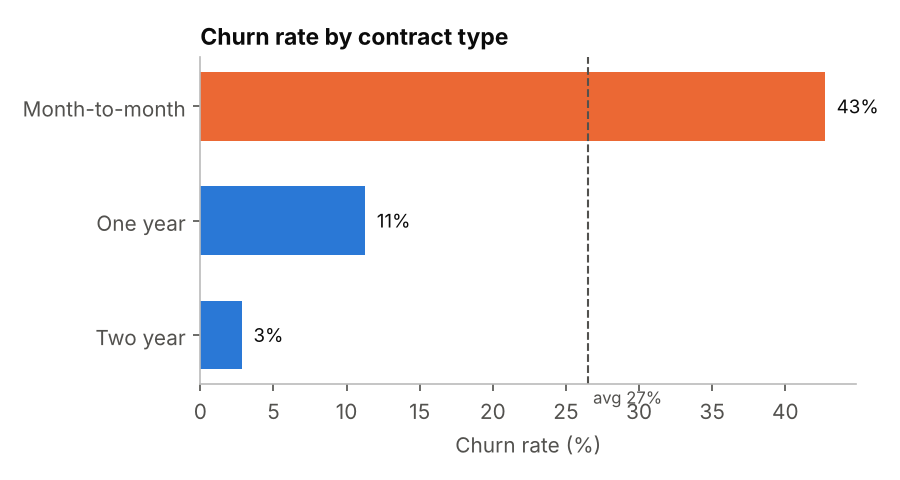
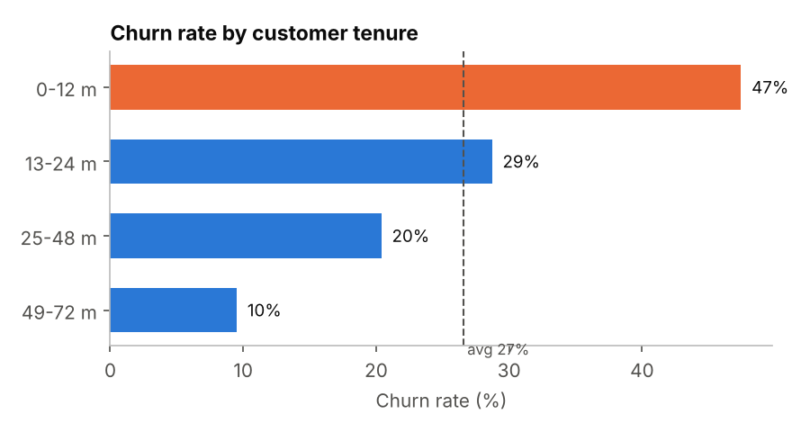
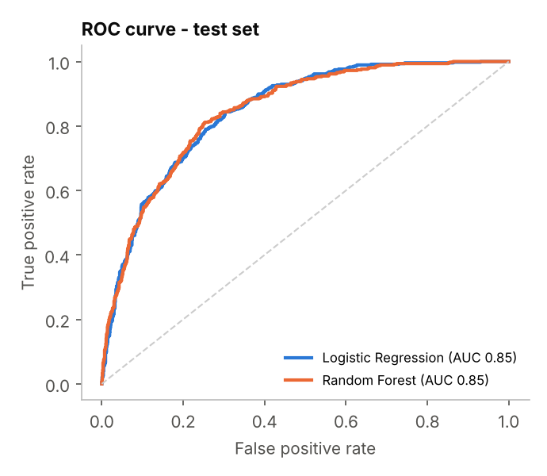
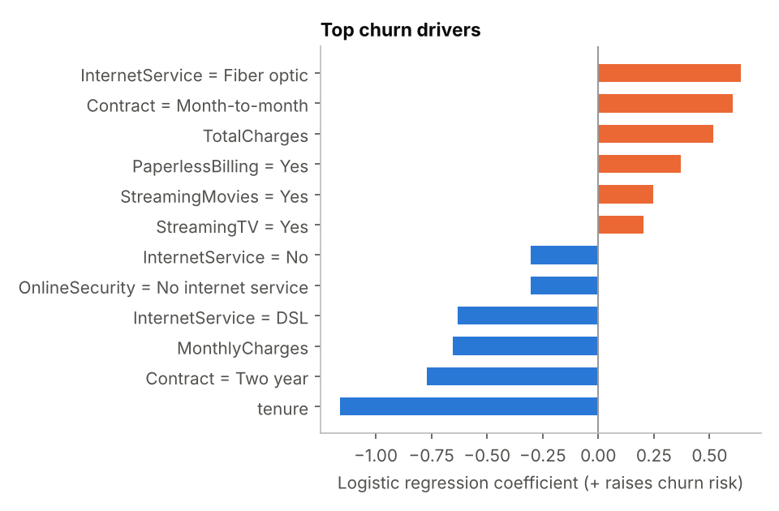

# Customer Churn Prediction & Revenue-at-Risk Analysis

Predicting which telecom customers are about to leave, explaining why, and sizing the revenue involved.

**Tools:** Python · Pandas · Scikit-learn · Matplotlib
**Data:** [IBM Telco Customer Churn](https://github.com/IBM/telco-customer-churn-on-icp4d), 7,043 customers, 21 attributes

## Business question
26.5% of customers churned, taking **$139K of monthly recurring revenue** with them. Which customers are at risk, what drives churn, and how much of that revenue could a retention campaign target?

## Key findings
| Insight | Figure |
|---|---|
| Month-to-month contracts churn far more than two-year contracts | **42.7% vs 2.8%** |
| Customers in their first 12 months are the most at risk | **47.4%** churn |
| Electronic-check payers churn ~3x more than auto-pay customers | **45.3% vs 15.2%** |
| Fiber-optic customers churn more than DSL customers | **41.9% vs 19.0%** |




## Model
Two models were trained on 75% of the data and evaluated on a held-out 25% test set:

| Model | ROC-AUC | Recall | Precision | F1 |
|---|---|---|---|---|
| Logistic Regression | 0.846 | 0.797 | 0.519 | 0.628 |
| Random Forest | 0.846 | 0.812 | 0.532 | 0.643 |

Logistic regression was kept for its interpretability: equal AUC, with coefficients the business can read.




## Business impact
- A high-risk list (churn probability >= 0.6) covers **34% of customers** but captures **72% of churners** and **76% of churned revenue**.
- Retention efforts can focus on one third of the base instead of everyone.

## Recommendations
1. Offer incentives to move month-to-month customers onto 1- or 2-year contracts.
2. Build a structured onboarding programme for the first 12 months.
3. Promote automatic payment methods over electronic checks.
4. Investigate fiber-optic service quality and pricing.

## Data quality
- 0 duplicate customer IDs.
- 11 blank `TotalCharges` values, all customers with 0 months of tenure, set to 0.

## Run it
```bash
pip install pandas scikit-learn matplotlib
python churn_analysis.py   # prints the analysis, writes images/ and results.json
```
